<p align="center">
  
</p>

<p align="center"><em>내 컴퓨터에 침투한 clawd</em></p>

<p align="center">
  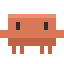
  
  
  
  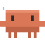
  
  
  
  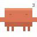
</p>

<h1 align="center">oh-my-clawd</h1>

<p align="center">
  <strong>Claude Code를 위한 상태 표시줄 + 메뉴바 다마고치</strong>
</p>

<p align="center">
  <a href="README.md">English</a> · 한국어
</p>

<p align="center">
  <a href="https://github.com/Hoya324/oh-my-clawd/releases/latest/download/OhMyClawd.dmg"></a>
  
  = 18" />
  
</p>

---

## 미리보기

```
[HUD] | 5h:14%(3h51m) | wk:62%(3d5h) | session:29m | ctx:39% | 53 | agents:2 | opus-4-6
```


## 설치

### DMG 다운로드 (권장)

[최신 릴리스 페이지](https://github.com/Hoya324/oh-my-clawd/releases/latest/download/OhMyClawd.dmg)에서 `.dmg` 파일을 다운로드하여 설치합니다.

DMG 하나로 끝나요. 앱이 처음 실행될 때 HUD와 세션 집계 스크립트를 `~/.claude/pet/runtime`에 설치하고, 집계 데몬(LaunchAgent)도 직접 등록합니다. Node.js가 없어도 앱과 사용량 표시는 동작하고, Claude Code 세션 추적만 꺼집니다.

### 수동 설치

```bash
git clone https://github.com/Hoya324/oh-my-clawd.git ~/.oh-my-clawd
~/.oh-my-clawd/install.sh        # HUD 상태 표시줄
~/.oh-my-clawd/pet/install.sh    # 메뉴바 앱 (소스 빌드)
```

설치 후 **Claude Code를 재시작**하세요. 기존 상태 표시줄이 있었다면 백업해 두었다가 `install.sh remove` 때 되돌립니다.

## HUD 상태 표시줄

| 세그먼트 | 설명 | 색상 로직 |
|----------|------|-----------|
| `5h:14%` | 5시간 요청 한도 사용률 | 초록 < 70% < 노랑 < 90% < 빨강 |
| `(3h51m)` | 5시간 한도 초기화까지 남은 시간 | 흐린색 |
| `wk:62%` | 주간 요청 한도 사용률 | 위와 동일 |
| `session:29m` | 현재 세션 지속 시간 | 초록 < 30분 < 노랑 < 60분 < 빨강 |
| `ctx:39%` | 컨텍스트 윈도우 사용률 | 초록 < 70% < 노랑 < 85% < 빨강 |
| `53` | 세션 내 총 도구 호출 횟수 | -- |
| `agents:2` | 현재 실행 중인 에이전트 수 | 청록색 |
| `opus-4-6` | 활성 모델 | 흐린색 |

## Clawd — 메뉴바 동반자

macOS 메뉴바에 상주하는 다마고치 스타일의 32x32 픽셀아트 캐릭터입니다.
Claude Code의 공식 마스코트인 **Clawd**(#D97757)가 Claude Code 활동에 실시간으로 반응합니다.

> 9가지 상태 | 3단계 활동 레벨 | 14종 액세서리 | Claude 기반 Companion

### Clawd 상태

| 상태 | | 한국어 | 조건 |
|------|--|--------|------|
| Sleeping |  | 자고 있어요... | 활성 세션 없음 |
| Waking up | 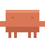 | 깨어나는 중! | idle→active 전환 |
| Walking |  | 신나게 걷는 중 | 기본 활성 상태 |
| Working hard |  | 열심히 일하는 중! | 도구 호출 50회 이상 |
| Bloated |  | 컨텍스트가 가득... | 컨텍스트 70% 이상 |
| Stressed |  | 레이트 리밋 경고! | 요청 한도 80% 이상 |
| Tired |  | 피곤해요... | 45분 이상 세션 |
| Collab |  | 함께 일하는 중! | 에이전트 2개 이상 |
| Chatting | 💬 | Claude랑 대화 중 | Claude Code 세션 없이 Claude 데스크톱 앱 사용 중 |

### 메뉴바 사용량 표시

Clawd 옆에 5시간 사용률이 바로 보여요 (`[Clawd] 42%`). 팝오버 하단의 **메뉴바 사용량**에서 `끔 / 5h / 5h+주`를 고를 수 있고, 마우스를 올리면 초기화까지 남은 시간이 나옵니다. 70% 이상은 주황, 90% 이상은 빨강.

- 팝오버에는 현재 세션과 이번 주 사용률, 초기화 시각(`오후 7:50에 초기화`), 사용 속도 한 줄 요약(`순조로워요. 일요일에 초기화될 때까지 여유 있게 쓸 수 있어요.`)이 나와요.
- 값은 **Claude Code가 상태 표시줄(HUD)로 공식 제공하는 사용량**(`rate_limits`)이에요. 그래서 HUD가 켜져 있어야 하고, Claude Code를 쓸 때 갱신돼요. Pro, Max 구독에서만 제공돼요.
- 한도는 계정 단위라서 claude.ai, 데스크톱 앱, 모바일 사용량도 포함돼요. 다만 그 사용분은 다음 Claude Code 응답 때 반영돼요.
- 오래된 값은 메뉴바에서 흐리게 보이고, 팝오버에 "n분 전 Claude Code 기준"으로 표시돼요. 초기화 시각이 지난 창은 "초기화됨"으로 바뀌어요.

> **왜 직접 조회하지 않나요?** Anthropic 약관상 구독 로그인(OAuth)은 Claude Code와 Claude.ai 전용이라, 다른 앱이 그 토큰으로 API를 부르거나 갱신하면 안 돼요. Clawd는 Claude Code 로그인 정보를 읽지 않고, Claude Code가 공식으로 넘겨주는 값만 써요.
- 80%, 95%를 넘을 때 5시간 창마다 한 번씩만 알림을 보냅니다.

### Claude 채팅 감지

Claude Code 세션이 없어도 Clawd가 반응합니다.

- **Claude 데스크톱 앱이 앞에 있을 때** 말풍선을 띄운 "대화 중" 상태가 됩니다.
- 물/스트레칭 리마인더도 채팅 중일 때 동작합니다.
- 대화 내용이나 앱 내부 파일, 브라우저 데이터는 읽지 않습니다. 그래서 어떤 대화인지, 응답을 생성 중인지는 알 수 없어요.

### 모션

상태별로 가끔 랜덤 모션을 보여주고, 클릭할 때마다 다른 반응을 합니다.

| 모션 | 나오는 때 |
|------|-----------|
| 깡총, 춤, 두리번, 하트 | 기본, 협업, 채팅 중 / 클릭 반응 |
| 고개 끄덕, 반짝 | 열심히 일하는 중 |
| 덜덜 (땀방울), 깜짝 (!) | 사용량 경고. 80%를 넘는 순간에도 |
| 한숨 | 컨텍스트 가득, 피곤 |
| 뒤척임 | 자는 중 |
| 축하 (점프 + 반짝이) | 액세서리 해금, 5시간 창 초기화 |

액세서리는 모션 중에도 몸과 함께 움직입니다.

### 활동 레벨

동시 실행 에이전트 수에 따라 Clawd의 활동 레벨이 달라집니다.

| 레벨 | 조건 | 설명 |
|------|------|------|
| Normal (보통) | 에이전트 0-1개 | 기본 상태 |
| Glowing (빛나는 중) | 에이전트 2-3개 | 발광 효과 |
| Supercharged! (슈퍼차지!) | 에이전트 4개 이상 | 최대 에너지 |

### 액세서리 컬렉션 (14종)

Claude Code 사용 실적에 따라 Clawd에게 착용시킬 액세서리를 해금할 수 있습니다.
모자, 안경, 바지를 자유롭게 조합하여 나만의 Clawd를 꾸며보세요!

#### 모자 (5종)

| 액세서리 | | 해금 조건 |
|----------|--|-----------|
| 캡모자 (Cap) | 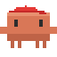 | 세션 10회 |
| 꼬깔모자 (Party Hat) |  | 총 사용 시간 5시간 |
| 산타모자 (Santa Hat) |  | 토큰 50만 사용 |
| 실크햇 (Silk Hat) |  | 에이전트 실행 50회 |
| 카우보이모자 (Cowboy Hat) |  | 총 사용 시간 30시간 |

#### 안경 (4종)

| 액세서리 | | 해금 조건 |
|----------|--|-----------|
| 뿔테안경 (Horn-rimmed) | 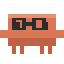 | 동시 세션 3개 이상 |
| 선글라스 (Sunglasses) | 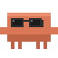 | 요청 한도 도달 10회 |
| 둥근안경 (Round Glasses) | 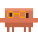 | 긴 세션(45분+) 20회 |
| 별안경 (Star Glasses) | 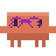 | Opus 모델 사용 10시간 |

#### 바지 (5종)

| 액세서리 | | 해금 조건 |
|----------|--|-----------|
| 청바지 (Jeans) | 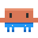 | 총 사용 시간 15시간 |
| 반바지 (Shorts) | 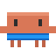 | 세션 100회 |
| 정장바지 (Slacks) |  | 토큰 100만 사용 |
| 운동바지 (Joggers) | 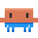 | 에이전트 실행 100회 |
| 카고바지 (Cargo Pants) | 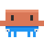 | 총 사용 시간 50시간 |

### Clawd 패션쇼

모자 + 안경 + 바지를 자유롭게 조합하면 나만의 스타일이 완성됩니다.

<p align="center">
  
  
  
  
  
  
  
</p>

<p align="center">
  <sub>캐주얼 · 젠틀맨 · 카우보이 · 파티 · 산타 · 너드 · 스포티</sub>
</p>

> 총 **5 x 4 x 5 = 100가지** 이상의 조합이 가능합니다. (미착용 포함 시 더 많아요!)

## Clawd Companion

Clawd는 단순한 장식이 아니라, Claude Code(`claude -p`, Haiku 모델)로 동작하는 가벼운 데일리 어시스턴트입니다. 자연어로 입력하면 시간을 해석해 메모로 저장하거나, 리마인더를 켜고 끄거나, 그냥 대화도 해줘요.

<p align="center">
  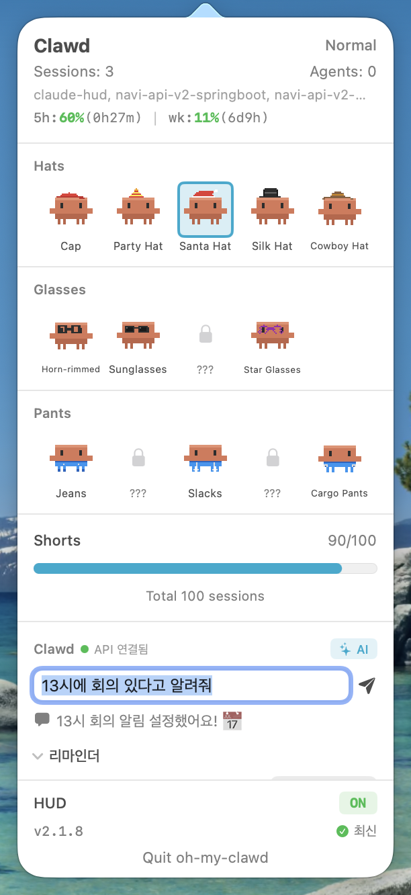
</p>

### 자연어 메모 + 리마인더

한국어/영어 자연어 그대로 말하면 Clawd가 시각을 해석해서 메모에 `dueAt`을 붙이고, 해당 시각에 macOS 알림을 발화합니다.

<p align="center">
  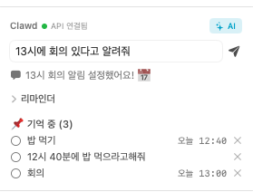
</p>

- `3시에 회의 있다고 알려줘` → `dueAt: 15:00` 메모, 3시에 알림
- `12시 40분에 밥 먹으라고` → `dueAt: 12:40` 메모
- `오늘 뭐 기억해둔 거 있어?` → 열린 메모를 답변으로만 알려줌
- `스트레칭 알림 2시간마다` → 스트레칭 리마인더 120분으로 전환

### 스케줄 리마인더

세 가지 기본 습관 알림. 각각 on/off + 간격 조절 가능.

<p align="center">
  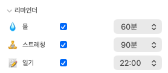
</p>

| 종류 | 기본 주기 | 발화 조건 |
|------|-----------|-----------|
| 💧 물 | 60분마다 | Claude 세션 활성 시 |
| 🧘 스트레칭 | 90분마다 | Claude 세션 활성 시 |
| 📝 일기 | 매일 22:00 | 오늘 Claude 사용 기록 있을 때 |

네이티브 macOS 알림으로 발화, 종류별 쿨다운, 설정은 `~/.claude/pet/clawd-memory.json`에 영속 저장됩니다.

<p align="center">
  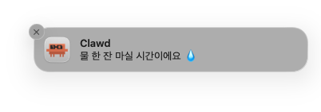
  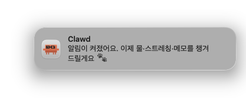
</p>

### 메모 전용 모드 (AI 안 쓰기)

간단한 기록에 쿼터 쓰기 싫을 때는 Clawd 헤더의 `✨ AI` 칩을 탭하세요. `✏️ 메모`로 바뀝니다. 이 모드에서 입력한 텍스트는 **즉시** 생 메모로 저장됩니다 — LLM 호출 없음, 네트워크 없음, 토큰 소비 0. 다시 탭하면 AI 모드로 복귀.

<p align="center">
  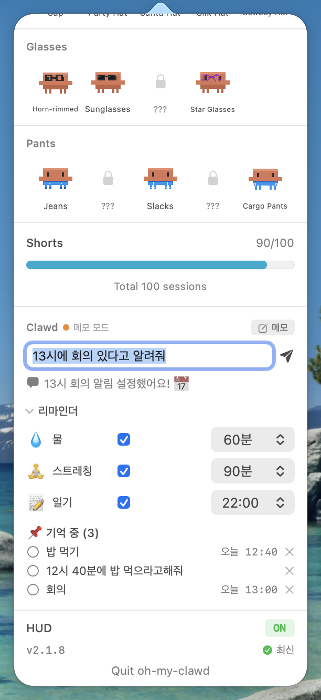
</p>

- **AI 모드**: 자연어 시간 해석(`"3시에 ..."`), 리마인더 등록, 대화
- **메모 모드**: 빠른 기록(`"보일러 점검"`, `"장봐야함"`)

### 동작 방식

- **Claude Code CLI로 실행**: 이 Mac에 설치된 `claude`를 `claude -p`로 실행해요. 로그인과 과금은 Claude Code가 그대로 처리하고, Clawd는 토큰을 직접 다루지 않아요.
- `claude`가 없거나 로그인이 풀려 있으면 팝오버에 원인과 해결 방법이 나와요. 그동안은 메모 모드로 기록할 수 있어요.
- "3분 뒤" 같은 상대 시간은 앱이 직접 계산하고, 지난 시각으로 해석된 메모는 시간 없이 저장한 뒤 알려줘요.
- **웹 질문** (날씨, 기사, 사실 질의) 은 Claude 내장 WebFetch / WebSearch로 자동 처리. 별도 설정 없음.

## 업데이트

**앱 내 자동 설치.** 런치 후 몇 초 뒤 GitHub에 신버전을 확인합니다. 업데이트가 있으면 팝오버 하단에 `v<현재> → v<신규> 설치` 버튼이 표시됩니다. 클릭하면 Clawd가 DMG를 다운로드해서 자기 자신을 교체하고 재시작합니다. 브라우저 필요 없음.

설치 전에 릴리스의 SHA-256, Developer ID 서명(같은 팀), Gatekeeper 공증을 모두 확인하고, 새 앱을 옆에 복사해 검증한 뒤 교체합니다. 중간에 실패하면 기존 앱은 그대로 남아요.

`최신` 라벨을 클릭하면 수동으로 다시 확인합니다.

## 요구사항

- **macOS 13.0+**
- **Node.js >= 18**: HUD와 Claude Code 세션 추적용 (없어도 앱과 사용량 표시는 동작)
- **Claude Code** (Pro 또는 Max 로그인): 사용량 표시와 Clawd 대화용

## 제거

```bash
~/.oh-my-clawd/install.sh remove        # HUD만 제거 (이전 상태 표시줄 복원)
~/.oh-my-clawd/pet/install.sh remove    # 앱 + 집계 데몬 제거, 메모와 진행도는 보존
~/.oh-my-clawd/pet/install.sh remove --purge   # ~/.claude/pet 데이터까지 삭제
rm -rf ~/.oh-my-clawd
```

### 데이터 위치

모든 파일은 `~/.claude/pet/` 아래에만 생기고, 프로젝트 폴더에는 아무것도 쓰지 않아요.

| 파일 | 쓰는 쪽 | 내용 |
|------|---------|------|
| `pet-state.json` | 집계 데몬 | 현재 세션, 사용량 |
| `progress.json` | 집계 데몬 | 누적 통계, 해금 |
| `selection.json` | 앱 | 착용 중인 액세서리 |
| `usage-cache.json` | 앱, HUD | 사용량 캐시 (공유) |
| `sessions/<id>.json` | HUD | 세션별 상태 |
| `clawd-memory.json` | 앱 | 메모, 리마인더, 대화 (일별 백업: `backups/`) |
| `runtime/` | 앱, install.sh | HUD, 집계 스크립트 |

## 라이선스

MIT

---

이 프로젝트는 MIT 라이센스를 따릅니다. 단, Clawd 캐릭터 디자인의 저작권은 [Anthropic](https://anthropic.com)에 있습니다. 본 프로젝트는 비상업적 팬 프로젝트이며, 상업적 용도로 사용할 수 없고, 사용할 생각도 없습니다. 저작권 관련 문제가 발생할 경우 즉시 삭제하겠습니다. 살려주세요.
